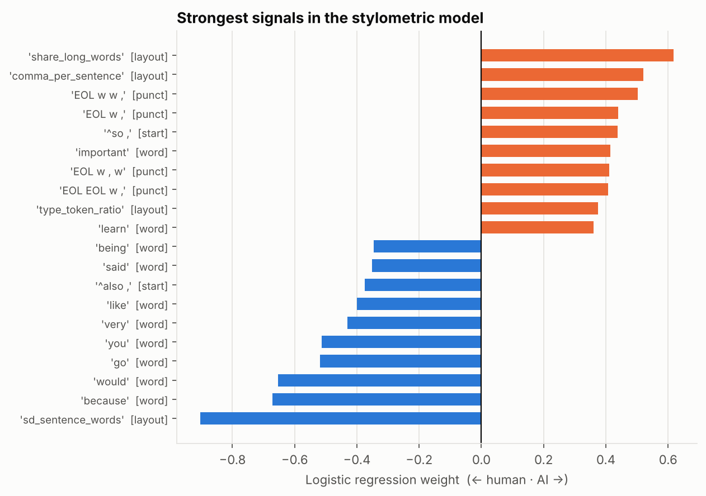

# What Makes Writing Sound Human? AI vs Human Text Detection

Most AI-text detectors look for the fingerprints of machine writing. This project asks the opposite question: **which features of a text mark it as written by a person?** A logistic regression is trained on stylistic features: word endings, punctuation rhythm, how sentences open, and line structure. Its weights are then read to see what separates the two classes.

This is a Python rebuild of my [text mining study](https://clara-co.github.io/projects/ai-vs-human-report.pdf), which I originally ran in LightSIDE. The rebuild uses the same dataset, sampling design, preprocessing and model family, implemented with scikit-learn so the whole experiment reruns with one command.

## Results

Balanced 1,000 train / 1,000 test sample from the full 487,235-essay corpus (full page: [`outputs/RESULTS.md`](outputs/RESULTS.md), written by the run itself):

| Model | Test accuracy | Cohen's κ | 5-fold CV (train) |
|---|---|---|---|
| Baseline: word 1-2 grams | **98.3%** | 0.966 | 97.5% ± 0.6 |
| Stylometric (cleaned text) | **98.0%** | 0.960 | 98.0% ± 1.0 |

The stylometric model reproduces the **98.1%** of the original LightSIDE study. In this rebuild, though, plain word n-grams do just as well: the original study's 81% baseline came from a different LightSIDE setup. What the stylometric model adds is **interpretability**. Its strongest signals confirm the original findings:

- **Human writing** varies its sentence length more, and explains itself with *because*, *would*, *being* and *said*.
- **AI writing** uses more long words and more commas per sentence, and opens sentences with discourse markers like *"So,"*.



The model is confident and well separated (mean confidence 0.97 when right), and its 20 errors are less certain (0.77). [`outputs/errors.csv`](outputs/errors.csv) lists them, closest calls first.

## Data

[AI Vs Human Text](https://www.kaggle.com/datasets/shanegerami/ai-vs-human-text) on Kaggle: `AI_Human.csv`, about 487,000 essays labeled human (≈305k) or AI-generated (≈181k), on topics such as politics, the environment, transportation and personal reflection.

## Design

| Step | What | Why |
|---|---|---|
| Sample | Balanced, disjoint 1,000 train / 1,000 test (`--n-train` to scale up) | Matches the original study. Balancing means a constant guess scores 50%, so accuracy is meaningful. |
| Clean | Remove long quotations, block quotes, `[n]` and (Author, Year) citations | The original error analysis found that quoted human writing pushed essays toward "human" |
| Baseline | Word unigrams + bigrams | The first LightSIDE model |
| Stylometric | 5 feature groups (below), `min_df = 2` | The cutoff removed most noisy one-off misspellings |
| Model | L2 logistic regression (liblinear) | Interpretable weights. Same model family as the original. |
| Evaluate | Accuracy, Cohen's κ, F1, 5-fold CV on train, confusion matrix, confidence of errors, every misclassified text | |

### Stylometric feature groups (`src/aivh/features.py`)

| Group | Example features | Captures |
|---|---|---|
| `word` | `because`, `would`, `n't` | function words people use to explain themselves |
| `sub` | `ally`, `nce ` (char 3-5 grams) | the "-ally" / "-nce" suffix pattern the original study found AI favors |
| `punct` | `w , w`, `w . EOL` | punctuation rhythm with the words masked out |
| `start` | `^in conclusion`, `^so ,` | how sentences open, so the marker "So," differs from a mid-sentence "so" |
| `layout` | sentence-length mean/SD, line length, type-token ratio | overall structure |

## Run it

```bash
python -m venv .venv && source .venv/bin/activate
pip install -e ".[dev]"

# Kaggle API token in ~/.kaggle/kaggle.json (Kaggle -> Settings -> API -> Create New Token)
./scripts/download_data.sh

python -m aivh                    # original design: 1k / 1k
python -m aivh --n-train 20000    # larger sample, same test size
pytest                            # 7 tests
```

Outputs: `outputs/metrics.json`, `outputs/RESULTS.md`, `outputs/top_features.csv`, `outputs/errors.csv` and two figures.

## Project layout

```
src/aivh/
  data.py         load AI_Human.csv, de-duplicate, balanced disjoint split
  preprocess.py   remove quotations, block quotes, citations
  features.py     baseline and stylometric feature unions
  model.py        pipeline, evaluation, cross-validation, top features, error table
  __main__.py     run both models, write outputs and RESULTS.md
tests/            unit tests + a smoke test on a synthetic corpus (checks the plumbing, not accuracy)
```

## Limitations

- The corpus doesn't record which AI models generated its essays, so results may not transfer to newer models.
- Weights can be compared within a feature group, but not across groups, because the groups are on different scales (binary, TF-IDF, standardized).
- Some essays in the corpus contain character-level noise (for example "TX" in place of "to"), which appears among the misclassified texts.
- Polished human writing and casual AI writing are the hard cases. `errors.csv` is sorted so the closest calls come first.

**Tools:** Python, scikit-learn, pandas, matplotlib, pytest. The original study was done in LightSIDE.
