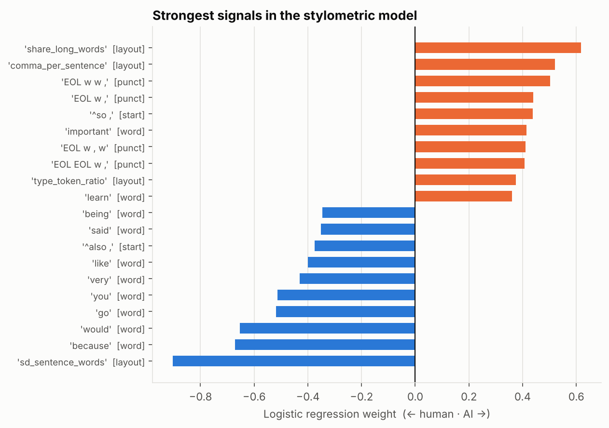
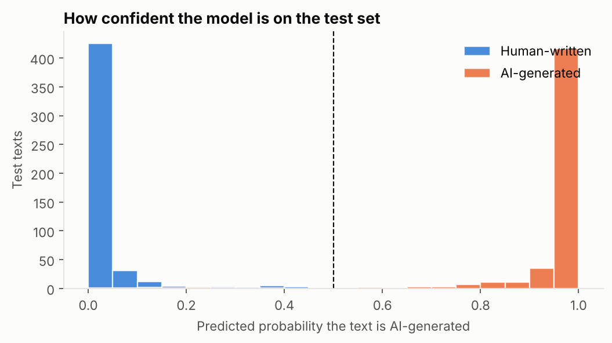

# Results

_Generated by `python -m aivh`.

Corpus: 487,235 unique texts. Balanced sample: 1,000 train / 1,000 test, seed 42.

| Model | Test accuracy | Cohen's κ | F1 (AI) | 5-fold CV accuracy (train) | Features |
|---|---|---|---|---|---|
| Baseline: word 1-2 grams | 0.983 | 0.966 | 0.983 | 0.975 ± 0.006 | 41,646 |
| Stylometric (cleaned text) | 0.980 | 0.960 | 0.980 | 0.980 ± 0.010 | 51,077 |

## Stylometric model: confusion on the test set

| | Predicted human | Predicted AI |
|---|---|---|
| **Human** | 490 | 10 |
| **AI** | 10 | 490 |

## What the model relies on

- **Human-leaning:** `sd_sentence_words` (layout), `because` (word), `would` (word), `go` (word), `you` (word), `very` (word), `like` (word), `^also ,` (start), `said` (word), `being` (word)
- **AI-leaning:** `share_long_words` (layout), `comma_per_sentence` (layout), `EOL w w ,` (punct), `EOL w ,` (punct), `^so ,` (start), `important` (word), `EOL w , w` (punct), `EOL EOL w ,` (punct), `type_token_ratio` (layout), `learn` (word)

Full list: [`top_features.csv`](top_features.csv).

## Confidence and errors

Mean confidence when right: 0.97. When wrong: 0.77. 20 test texts were misclassified; [`errors.csv`](errors.csv) lists them, closest calls first.
